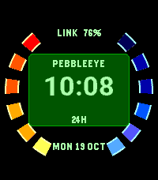
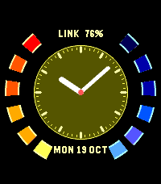
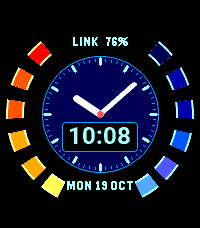
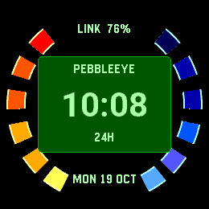
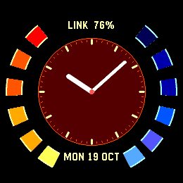
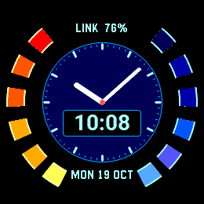

# PebbleEye

A spy-watch display for **Pebble Time 2** (Emery, 200×228) and **Pebble Round 2**
(Gabbro, 260×260). Segmented red/gold and blue rings frame a digital, analogue or
hybrid clock. Eight coordinated palettes are available in all three modes: Classic, Amber, Ice,
Orchid, Lagoon, Ember, Silver and Rose.

## Preview

| | Digital · Classic | Analogue · Amber | Hybrid · Ice |
| --- | --- | --- | --- |
| Time 2 |  |  |  |
| Round 2 |  |  |  |

[Store page and artwork](store/index.html) · [Listing copy](store/description.txt) ·
[Configuration page](resources/configure-pebbleeye.html)

## Features

- Full-size analogue hands, clear digital time, or digital time over the analogue dial.
- Eight coordinated colour palettes and five date formats.
- Smooth native time digits, with measured bounds and crisp date/status labels.
- Optional battery, phone connection and Quiet Time status (`Q`).
- Optional seconds hand while the backlight is on. Off by default; otherwise the
  face updates on minute ticks and settings/status events.
- Optional 12-second theme on a double tap of the watch, on Time 2 only. Off by
  default; respects mute and Quiet Time. Round 2 has no speaker.
- Optional three-second vibration rhythm on a double tap, on Time 2 and Round 2.
  Off by default; respects Quiet Time.
- Watch system 12-hour or 24-hour preference.
- Mobile settings with illustrative preview, Undo, Save and Cancel.
- Validated settings, preserved preferences and bounded delivery retries.

This is a separate app from Wordish. Its existing experimental UUID
`ec7e38a9-3852-4459-9265-597ebcfb678f` is preserved, along with the
`gabbroeye-hud-options-v1` phone storage key. The standalone release is **1.6.4**,
version code **21**, advancing the branch's 1.5.1. Older Pebble models are not supported.

## Build and verify

Requires Pebble SDK 4.33.1 with Emery/Gabbro support, the Pebble CLI, a host C
compiler, Python and Node.js.

```sh
make lint
make misc_checks
```

The installable bundle is `build/pebbleeye.pbw`. Checks cover two native builds,
circular layout bounds, settings validation, runtime lifecycle/backlight
subscriptions, and configuration delivery and form round-trips.

For native emulator captures, use pebble-tool's Python:

```sh
python scripts/capture_screenshots.py --platform emery
python scripts/capture_screenshots.py --platform gabbro
```

The helper owns dedicated ports 12544/12545 and leaves its emulators running.
It checks all three modes and palettes, five dates, midnight/noon in 12-hour
mode, and disconnected status. Raw images and source/bundle checksums stay in
ignored `build/screenshots/`. Only sixteen current promotional images are tracked: every palette on both watches.
Run `python3 scripts/prepare_store_screenshots.py` after capture to refresh them.
Physical watch contrast, battery endurance and the Pebble phone webview remain
separate device checks; emulator and host tests do not establish those results.

## Configuration hosting

Enable GitHub Pages for the repository's `main` branch, root folder. The bridge
opens `https://gloriouscode.github.io/pebbleeye/resources/configure-pebbleeye.html`
with a version query and saved settings in the fragment. The store concept is
available at `/pebbleeye/store/`. No separate web framework or build is needed.

## Origins

Split from [Wordish](https://github.com/gloriousCode/wordish), branch
`codex/gabbro-pebbleeye-hud`, commit `1d6028bb3785fc85e7fd8de4b9d2eefb797aa316`.
The source branch remains untouched. The experimental ring renderer originated
there; the standalone app removes its underlying fuzzy-text layers and resources.
The original word-clock project was [Fuzzy Text International](https://github.com/hallettj/Fuzzy-Text-International).

PebbleEye is an independent, unofficial homage to classic spy-game watch displays.

## Text rendering

Digital and hybrid time use native 24/28/34/42-pixel Roboto Bold coverage masks,
blended against the actual panel or black inset. All three masks share glyph
metrics; SDK measurements reject overflow before drawing. The small system-font
date and status labels retain their original rendering. This adds two text passes
per visible time readout, without new timers. Font data occupies 20,676 bytes;
font-only packaged resources total 24,784 bytes (7,455 bytes more than before).
Time 2 additionally includes a 192,000-byte audio resource; Round 2 omits it. Physical battery impact is
unmeasured. `scripts/generate_smooth_fonts.py` regenerates masks with pebble-tool’s
Python and SDK 4.33.1; tests cover all 1,440 times and all 64×64 colour blends.

## Gentle double taps

Wake the backlight, hold your wrist still, then tap gently twice within eight
seconds. Time 2 offers either **Double-tap music** or **Vibrate theme**; enabling
one switches the other off. Both may be off. Round 2 supports vibration only.
Old configurations containing both flags migrate to vibration.

The shared detector samples at 100 Hz in batches of ten only while the backlight
is lit, for up to eight seconds. It stops after one recognised gesture, when the
light goes out, or when disabled. Wake the light again to repeat. There is no
idle accelerometer subscription or polling timer. The recogniser rejects
sustained movement, recoil and vibration samples. Thresholds are covered by
synthetic tests; physical sensitivity and battery impact need watch measurements.

Music plays the approved 12-second clip on Time 2 and respects mute and Quiet
Time. It streams a 192,000-byte resource with a small RAM buffer; Round 2 still
omits the audio resource. Vibration plays a three-second rhythm on either model
and respects Quiet Time. It reproduces timing rather than musical pitch.
Changing mode or disabling an active mode stops its playback. Existing app UUID,
settings keys and configuration address are preserved.

## Playback test and diagnosis

On Time 2, **Save & test music** selects music, saves the current settings, closes
configuration and requests one playback without a gesture. The updated hosted
configuration page must be published for this control to appear. It is hidden
on Round 2 and older watchface builds. Normal saves, message retries and phone
reconnects do not replay the test. Mute and Quiet Time still apply.

Version 1.6.4 replaces the previous exact-position/80 ms settling rule with a
longer timestamp-based impulse filter. It tolerates modest orientation changes
and ringing. Faster sampling stays bounded to the same backlight window and
uses ten-sample batches, keeping callback frequency at ten per second. This
increases sensor work during those windows; actual battery impact is unmeasured.
App logs record window start/end, whether samples arrive, recognised gestures
and blocked speaker requests. Physical-watch confirmation remains required.
